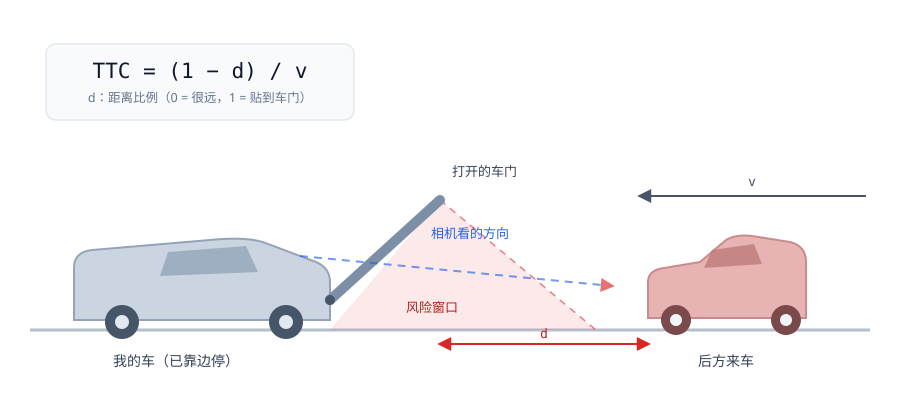

# DooringGuard · 开门杀风险预警

> 推开门的那个瞬间，后方 1.5 秒内会有车到 —— 这件事，人靠感觉判断不出来。

一个纯 Python、不需要任何硬件的小工具：读一段视频，判断「如果现在推开车门，会不会撞到后方来车」，
输出 **SAFE / CAUTION / DANGER** 三档判断，以及距离碰撞还有多少秒（TTC）。



## 为什么做这个

「开门杀」是城市道路里最常见、也最可预防的事故之一：路边停车，乘客拉开车门，
后方来的自行车、电动车来不及反应，直接被门推倒。它的成因不是人不小心，
而是**车门和后视镜之间存在一个结构性盲区** —— 你坐在车里，那个方向本来就看不见。

现有的对策基本是「喊一句小心」和「养成回头习惯」。前者靠不住，后者反人性。

这个项目想验证一件事：**能不能只用一个摄像头，把那个盲区里的风险量化成一个数字**，
让「要不要现在开门」变成一个可以判断的问题，而不是一个习惯问题。

## 它怎么工作

三步，全部可解释，没有黑盒模型：

| 步骤 | 做法 | 代码 |
|---|---|---|
| 1. 检测 | MOG2 背景建模 + 形态学 + 轮廓筛选，只在关注区域内找运动目标 | `dooring_guard/detect.py` |
| 2. 跟踪 | 贪心 IoU 匹配，给每个目标一条轨迹（按时间戳记，不按帧号） | `dooring_guard/detect.py` |
| 3. 判风险 | 用包围盒高度当距离代理量，算逼近速度与碰撞时间 | `dooring_guard/risk.py` |

风险判据就三个式子：

```text
d   = clip((h - h_far) / (h_near - h_far), 0, 1.15)   # 目标高度 h 映射成 0~1 的距离比例
v   = Δd / Δt                                          # 逼近速度
TTC = (1 - d) / v                                      # 还有几秒碰到车门
```

然后分档：

- `DANGER` — `d ≥ 0.92` 或 `TTC ≤ 1.5s`：**先别开门**
- `CAUTION` — `d ≥ 0.55` 或 `TTC ≤ 4.0s`：有东西在靠近
- `SAFE` — 其余

有两个工程细节，不加的话这东西根本没法用：

- **滞回**：已经在 CAUTION 了，要更宽松的条件才允许掉回 SAFE，否则告警会疯狂闪烁。
- **冷启动保护**：轨迹出现后的前 6 帧不判风险 —— 头几帧的距离变化率全是噪声，
  不信这个的话，视频一开始就会凭空报一次 DANGER。

## 30 秒跑起来

```bash
git clone https://github.com/majiachaojuedaningmeng-create/dooring-guard.git
cd dooring-guard
pip install -r requirements.txt
python main.py --demo
```

`--demo` 不需要任何素材：它会用 OpenCV 现场合成一段「后方来车从远处冲向车门」的测试视频，
验证 检测 → 跟踪 → 分级 → 渲染 这条链路是通的。

跑真实视频：

```bash
python main.py --source D:/videos/road.mp4 --out out   # 视频文件
python main.py --source 0 --display                     # 摄像头，按 q 退出
```

## 输出

终端会给一份小结：

```text
[out] 标注视频 -> out\annotated.mp4
[out] 事件记录 -> out\events.csv
[out] 危险关键帧 -> out\keyframe.jpg
----------------------------------------------------
处理帧数        180（约 6.0 秒）
告警事件        2 次（CAUTION 1 / DANGER 1）
最高风险等级    DANGER
最小碰撞时间    0.00 秒
```

`out/events.csv` 只记录**等级发生变化的时刻**，方便逐条回看：

```csv
t,track,level,distance_ratio,ttc
2.80,1,WARN,0.295,3.95
4.37,1,DANGER,0.633,1.49
```

## 参数

| 参数 | 默认 | 说明 |
|---|---|---|
| `--source` | 合成视频 | 视频路径，或摄像头编号 |
| `--roi` | 画面右侧 80% | 关注区域（归一化坐标），传 `none` 关闭 |
| `--near` | `0.50` | 「贴近车门」对应的目标高度占画面比例 |
| `--far` | `0.06` | 「远处」对应的目标高度占画面比例 |
| `--danger-ttc` | `1.5` | 触发 DANGER 的碰撞时间（秒） |
| `--warn-ttc` | `4.0` | 触发 CAUTION 的碰撞时间（秒） |
| `--engine` | `motion` | 换 `yolo` 可区分人/自行车/汽车（需 `pip install ultralytics`） |

`--near` / `--far` 是最需要按场地重标定的两个值：换个机位、换个镜头，
同样的物体在画面里的大小就完全不一样了。

## 项目结构

```text
dooring-guard/
├── main.py                    # 入口
├── dooring_guard/
│   ├── detect.py              # 运动检测 + IoU 跟踪 + 碎片合并
│   ├── risk.py                # 距离代理、TTC、滞回分级
│   ├── render.py              # 画面渲染（文字用英文，见下）
│   ├── yolo_engine.py         # 可选的 YOLO 引擎
│   └── cli.py                 # 命令行
├── tools/make_demo_video.py   # 合成测试视频生成器
├── docs/design.md             # 设计取舍与迁移路径
└── docs/geometry.svg          # 几何关系示意图
```

画面上的文字一律用英文：OpenCV 的 `putText` 不支持中文，在 Linux 板子上通常也没有中文字体，
硬写中文会渲染成方块。中文留给 README、CSV 和终端。

## 已知局限

写在这里的，都是我知道它现在做不到的：

1. **只能固定机位。** 手持抖动会让背景建模失效，需要先做稳像 —— 本版本没做。
2. **分不清人和车。** 默认引擎只会说「有东西在动」，这是速度换来的精度，用 `--engine yolo` 可以补。
3. **距离是代理量，不是真距离。** 用包围盒高度近似距离，只在特定机位、特定目标尺寸下成立，
   目标如果是卡车或行人，阈值就得重标。真值应该来自单目测距（已知车牌/轮径）或双目深度。
4. **没有在真实数据上验证过。** 目前的测试视频是程序合成的，只能说明 pipeline 连通，
   完全不代表真实场景的准确率。这是这个项目最欠缺的一块。

## 接下来

- [ ] 用真实路边视频重标 `--near` / `--far`，并统计误报率
- [ ] 换单目测距：用已知车牌尺寸反推真距离，替掉高度代理
- [ ] 迁移到地瓜 RDK X5：模型走官方工具链转 BPU，别在 CPU 上硬扛
- [ ] 接一个蜂鸣器 / 车内屏，做成能出声的实物
- [ ] 双摄像头：一路看后方来车，一路看车门开启角度

## 关于 AI 辅助

这个项目的代码在 AI 辅助下完成，包括结构设计、算法实现和文档。判据全部列在 README 和
`docs/design.md` 里，可以逐条核对，也可以逐条推翻重写。

## License

MIT © 2026 majiachaojuedaningmeng
